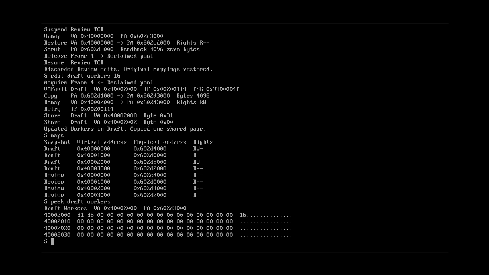

Split gives two seL4 workers private configuration snapshots through a userspace pager that copies shared pages on first write and scrubs discarded frames before reuse, with an Isabelle model exported to OCaml for checking guest memory operations.

